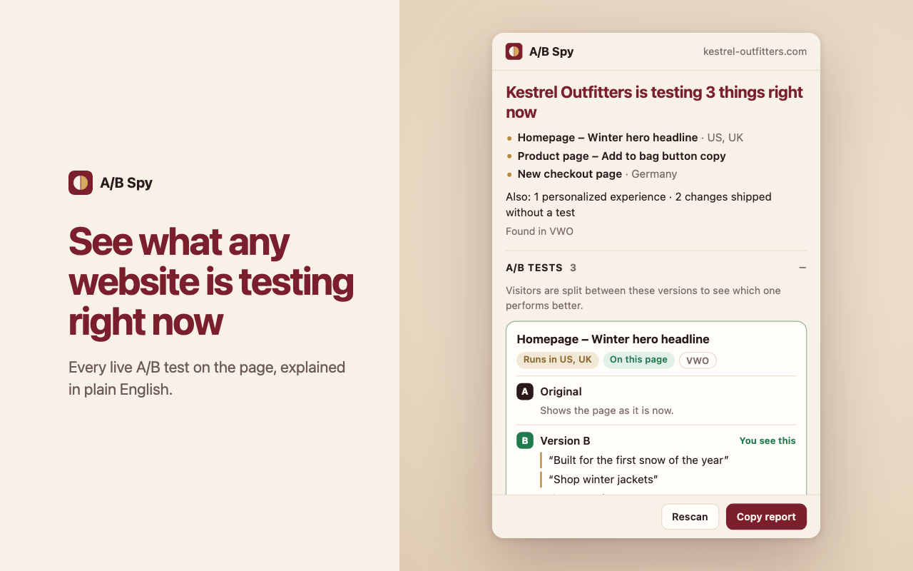

# A/B Spy

See the A/B tests any website is running right now: every version of the headline, the button, the image and the page, including the versions you aren't being shown.

## What it does

Open any website and the A/B Spy icon shows how many A/B tests are running there. Click it to see:

- **A one-line answer**: "ASOS is testing 3 things right now", with each test and the markets it runs in.
- **Every version** of each test in plain English: the new copy, new images and colours, where split tests send visitors, and what each change does ("Hides the hero", "Changes a background colour").
- **Which version you got**, so you know what everyone else might be seeing instead.
- **Tests sorted from everything else**: personalized content (different content for different audiences) and changes shipped without a test (fixes and launches released through the testing tool) are listed separately, so they don't inflate the test count.
- **Copy report**: the whole list as plain text, ready for a doc, a Slack message or a teardown.

Test names are cleaned up too: ticket numbers are removed, shorthand like "HP" and "PDP" is spelled out, and market codes become country names.

## Supported testing tools

| Tool | What A/B Spy can show |
| --- | --- |
| Optimizely Web | Tests, versions, new copy, images, redirects, pages |
| VWO | Tests, versions, new copy, images, split URLs |
| Convert | Tests, versions, traffic split, redirects, changes |
| AB Tasty | Tests, versions, changes |
| Kameleoon | Tests, versions |
| GrowthBook | Experiments and variation values |
| PostHog | Multivariate feature flags you're bucketed into |
| Adobe Target, Dynamic Yield, Monetate, LaunchDarkly, Statsig, Split, Mutiny, Intelligems, Shoplift, Evolv, SiteSpect, Amplitude Experiment | Detected only: these choose versions on their own servers, so the versions can't be read from the browser |

## How it works

Client-side testing tools send their test setup to every visitor's browser, because the browser is where they swap the headline or redirect the page. A/B Spy reads that setup from the page, pulls out the human-readable parts (copy, images, links) and shows them in a popup.

It reads nothing that isn't already sent to every visitor, and it never sends anything anywhere: no servers, no analytics, no accounts. See the [privacy policy](docs/privacy.html).

Notes:

- Some sites hide test names in their tool settings. Those show as "Name hidden by the site".
- Some changes are pure design or code (a colour, a hidden menu). Those show as "Design or code changes only".
- Some tools load a version's content only for visitors who get it. Those show as "loads only for visitors who get this version".

## Install

**From the Chrome Web Store:** coming soon.

**From this repository:**

1. Download the latest `.zip` from [Releases](../../releases) and unzip it, or clone this repository.
2. Open `chrome://extensions` in Chrome and turn on **Developer mode** (top right).
3. Click **Load unpacked** and choose the unzipped folder.

## Files

| File | Job |
| --- | --- |
| `detector.js` | Runs in the page, reads each testing tool's setup and builds the report |
| `bridge.js` | Passes the report from the page to the extension |
| `background.js` | Keeps the report per tab and shows the count on the icon |
| `popup.html`, `popup.css`, `popup.js` | The popup |

## License

[MIT](LICENSE)
